# App screenshots

Taken from the built app (`npm run build && npm start`) with the demo data, dark theme, 1400 px desktop and 390 px phone. Video: [app-walkthrough.mp4](app-walkthrough.mp4).

## 01 · inventory

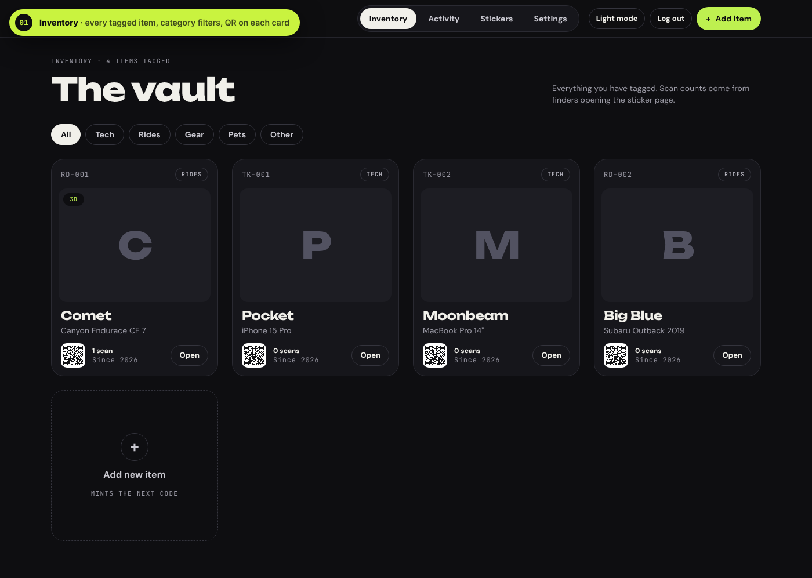

## 02 · add item

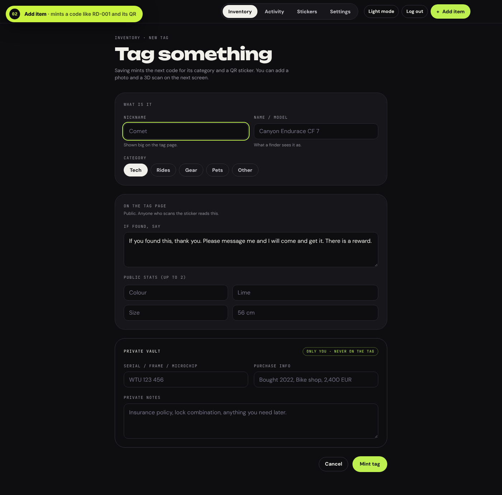

## 03 · item detail

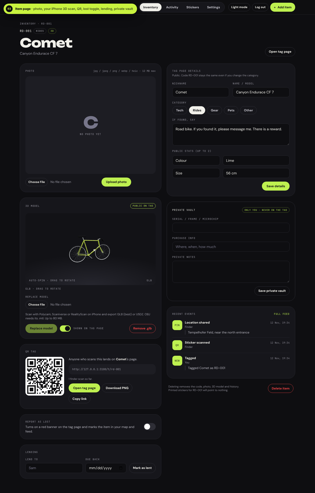

## 04 · tag page

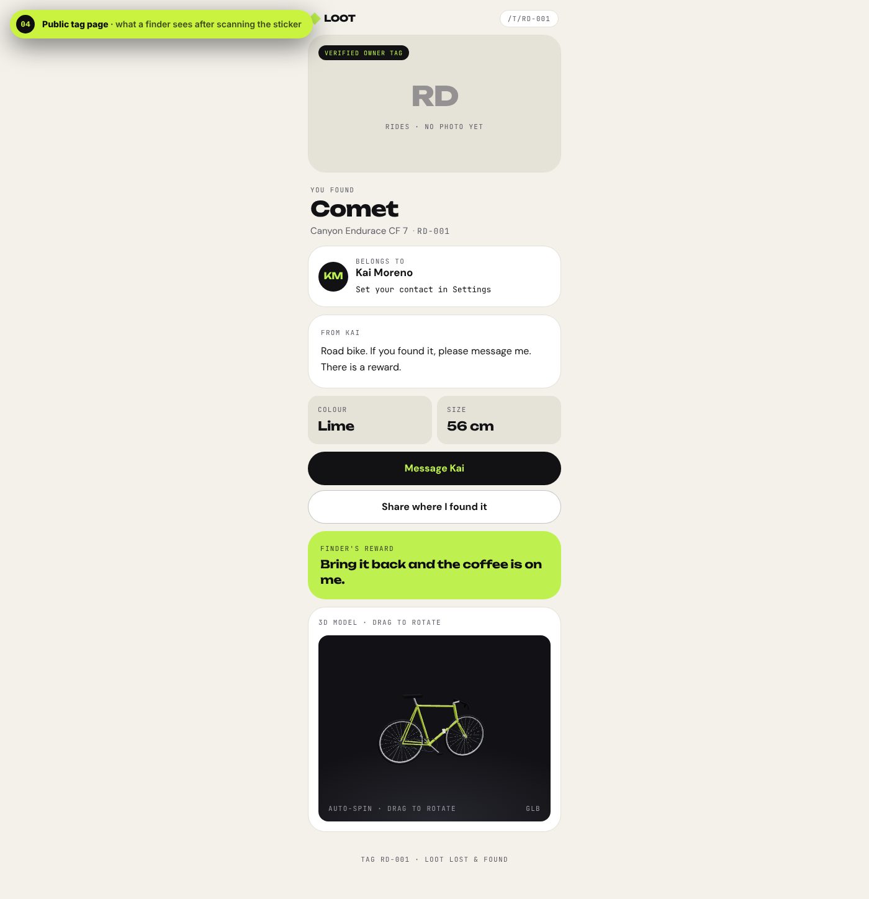

## 05 · activity map

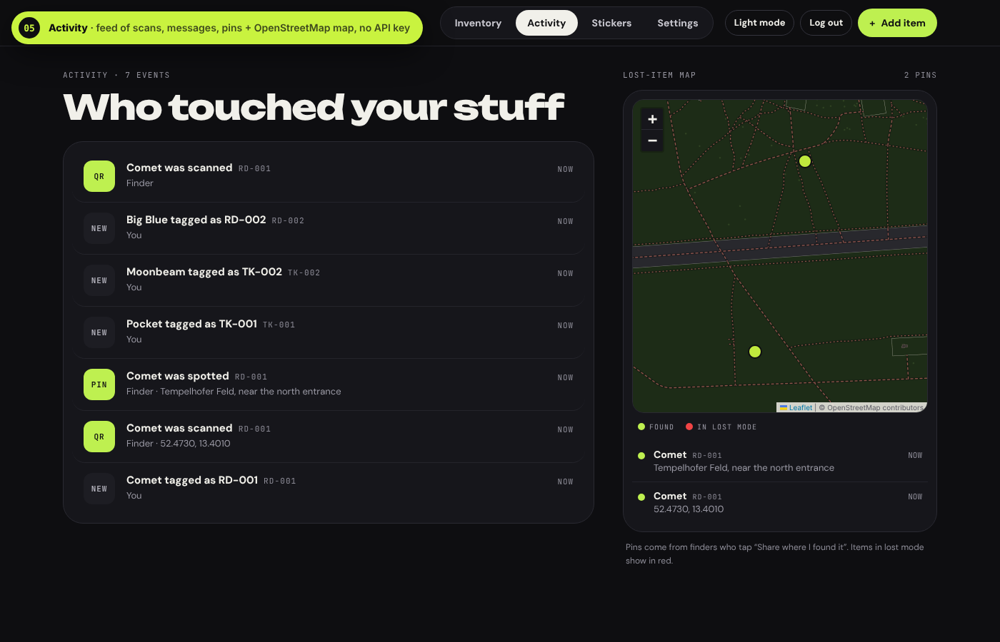

## 06 · stickers

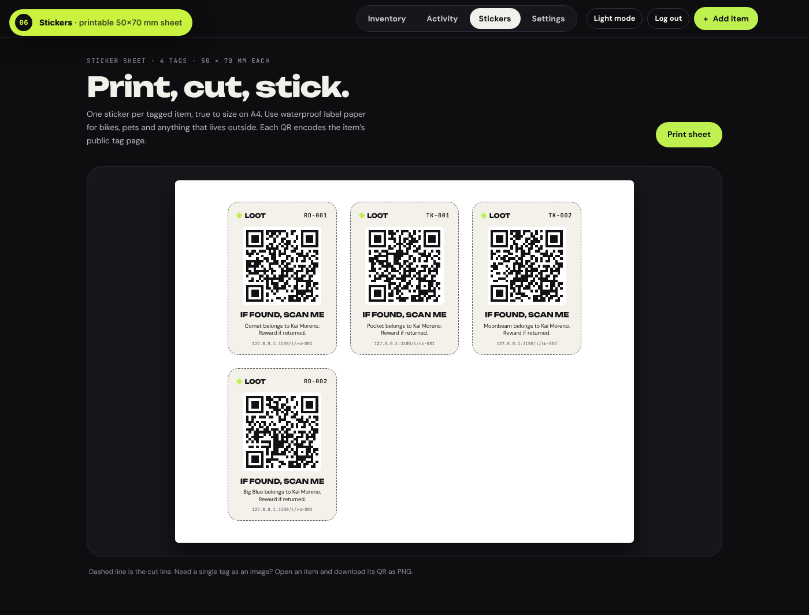

## 07 · settings

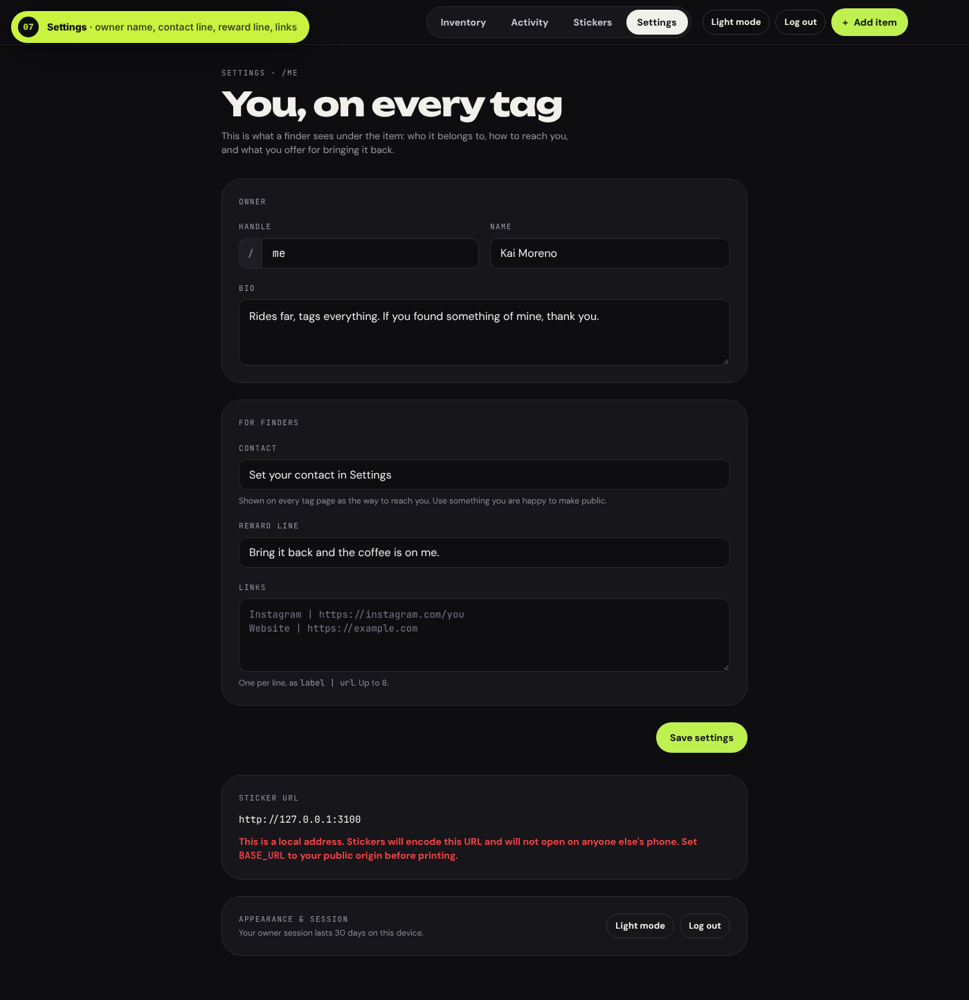

## 08 · login

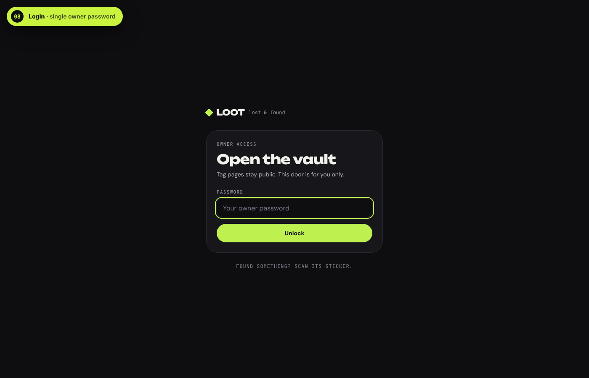

## 09 · inventory light

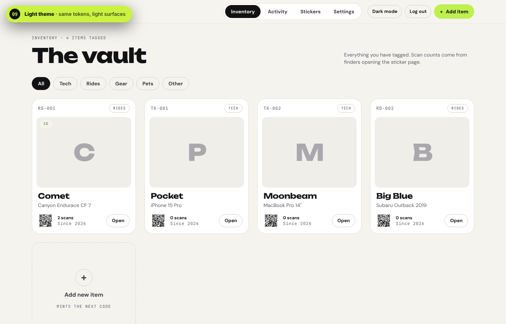

## 10 · phone tag page

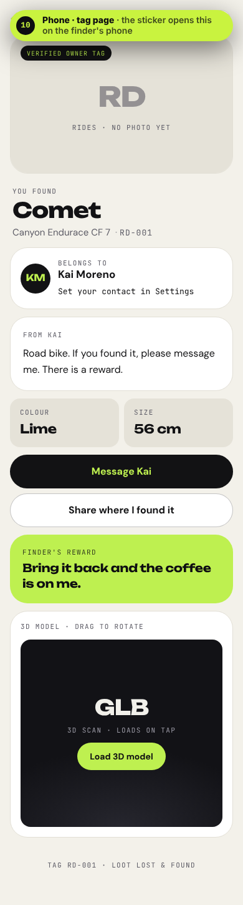

## 11 · phone inventory

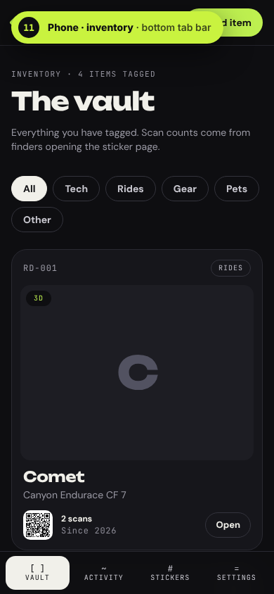

## 12 · phone item

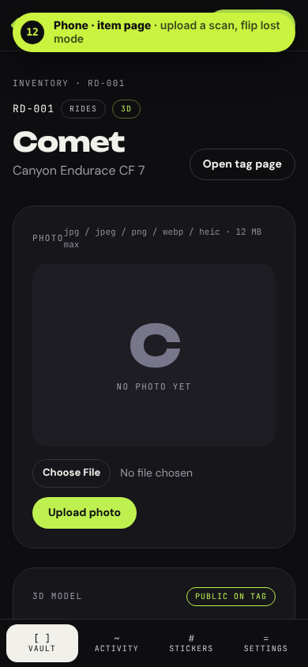

